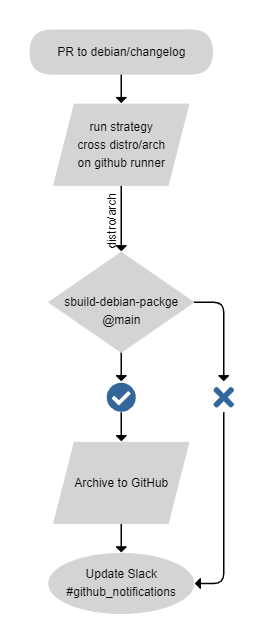
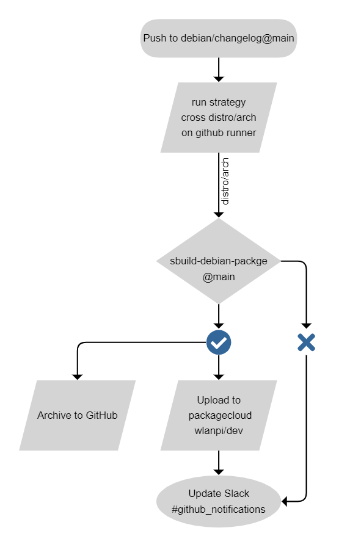

# Release process

This document covers the release procedures for core WLAN Pi team members. For general contribution guidelines and detailed Git workflow, see [Contributing](CONTRIBUTING.md).

> **For Git workflow details**: Branching strategy, merge strategies, and troubleshooting common scenarios are covered in [Contributing](CONTRIBUTING.md).

## Overview

`main` is the only long-lived development branch. A release is a pull request into `main`
that bumps the version. When it merges, the deploy workflow builds the package
and uploads it to Packagecloud.

## Branch strategy (Quick Reference)

General branching strategy. May vary per repo.

| Branch | Purpose |
|--------|---------|
| `main` | Only long-lived development branch; PRs target it |
| `debian/<codename>` | Preserved support for older Debian suites (core team only) |
| `feature/<desc>` | Shared long-term feature work |
| `fix/<desc>` | Bug fix branches |
| `chore/<desc>`, `docs/<desc>`, `ci/<desc>` | Non-feature maintenance |
| `security/<desc>` | Security fixes |
| `hotfix/<desc>` | Urgent fixes against `main` |
| `release/<version>` | Version bump for a release |

> `debian/<codename>` branches (e.g. `debian/bullseye`)
> are maintained by the core team. They are branched from a known-good commit
> before trixie-targeted work began. Build matrices on these branches target
> only their specific suite. Contributors should not open PRs against these
> branches.

### Branch rules

- **No direct commits to `main`** - All changes come via PRs from feature, fix, or release branches

**See [Contributing](CONTRIBUTING.md) for detailed workflow**, including:
- Feature branch workflow and keeping branches in sync
- Merge strategy (squash merge into `main`)
- Version collision handling
- Branch divergence recovery

## Creating a release

### 1. Prepare the release

Ensure all intended changes are merged to `main`, then create a release branch
from it:

```bash
git checkout main
git pull origin main
git checkout -b release/1.2.3
```

### 2. Update version and changelog

Update `debian/changelog` with the new version:

```bash
dch -v <version> "Release version <version>"
```

Example:
```bash
dch -v 1.2.3 "Release version 1.2.3"
```

For Python packages, set the same `major.minor.patch` in `__version__.py`
(see [Version gate](#version-gate)).

Commit these changes:
```bash
git add debian/changelog path/to/__version__.py
git commit -m "Bump version to 1.2.3"
```

### 3. Open and Merge the Release PR

Push the branch and open a PR against `main`. Merge it with **Squash and
merge** once CI passes.

### 4. Deploy to Packagecloud

The `debian/changelog` change reaching `main` triggers the
deployment workflow. Pushing the version tag does not trigger it.

1. Package is built automatically with `sbuild`
2. Uploaded to [wlanpi/dev](https://packagecloud.io/wlanpi/dev) with a
   `~gha<UTC timestamp>` build-metadata suffix on the version
3. Test the package
4. Once verified, promote from `dev` to `main` in Packagecloud

### 5. Tag the release

If the repo's deploy workflow calls `tag-release` from
[gh-workflows](https://github.com/WLAN-Pi/gh-workflows), skip this step. After
the upload, CI tags the deployed commit as `v<version>` without the Debian
revision, for example `v1.2.3` for `1.2.3-1`.

Otherwise, after the deploy succeeds, tag the merge commit on `main` with an
annotated tag:

```bash
git checkout main
git pull origin main
git tag -a v1.2.3 -m "Release version 1.2.3"
git push origin v1.2.3
```

## GitHub workflows

### Build and archive

Triggered by: Changes that affect build output in PRs (most repos watch
`debian/changelog`; some ignore docs-only changes)

Purpose: Build packages for testing without deploying

Use this to verify builds work before tagging.

### Deploy to Packagecloud

Triggered by: A `debian/changelog` change pushed to `main`.

Purpose: Builds the package and deploys it to the Packagecloud `dev` repository

Maintained by:

- Build logic: [sbuild-debian-package](https://github.com/WLAN-Pi/sbuild-debian-package)
- Reusable workflow files: [gh-workflows](https://github.com/WLAN-Pi/gh-workflows)
  (`sbuild-pkg`, `sbuild-deploy-pkg`, `check-py-deb-pkg-versions-match`,
  `get-formatted-version-string`, `tag-release`)
- Workflow files in each repo, which call the reusable workflows above

Promotion from the Packagecloud `dev` repository to `main`: Manually done on
Packagecloud (or, for repos that provide it, via a manual `promote-to-main.yml`
workflow).

### Version gate

Deploy workflows for Python repos call
`check-py-deb-pkg-versions-match`, which fails the build unless the
`major.minor.patch` in `debian/changelog` equals the value in the package's
`__version__.py`. Bump both together. See
[Style/Workflow](style/WORKFLOW.md#versioning).

### Lint workflows

Every repository should run the shared lint gate (rollout status in
[REPOS.md](REPOS.md#ci)):

- `shellcheck` over tracked shell scripts and shell-shebang executables
- `actionlint` over `.github/workflows/`

The canonical implementation is
[wlanpi-common/.github/workflows/lint.yml](https://github.com/WLAN-Pi/wlanpi-common/blob/main/.github/workflows/lint.yml).
New repositories should copy it as `.github/workflows/lint.yml`.

### Workflow diagrams

**Build and Archive:**



**Deploy to Packagecloud:**



## Merging Pull Requests

### For contributors

When merging external contributions, use **"Squash and merge"** by default:

1. Review the commit messages in the PR
2. Clean up any "fix typo", "address feedback" commits
3. Ensure the final commit message is descriptive
4. Click "Squash and merge"

This keeps the git history clean and readable.

### When NOT to squash

Use "Create a merge commit" when:
- The PR contains logically separate commits that should be preserved
- The contributor specifically requests commits be preserved (and there's good reason)

See [Contributing](CONTRIBUTING.md) for detailed merge strategy guidance.

## Troubleshooting

### Tag already exists

If you need to replace a tag (only before pushing):

```bash
git tag -d v1.2.3
git push origin :refs/tags/v1.2.3
git tag -a v1.2.3 -m "Release version 1.2.3"
git push origin v1.2.3
```

### Build failures

Check the GitHub Actions logs for:
- Missing dependencies in `debian/control`
- Syntax errors in `debian/rules`
- Missing files in `debian/install`

### Packagecloud issues

Contact Josh Schmelzle for Packagecloud issues.

## See also

- [Contributing](CONTRIBUTING.md) - General contribution guidelines and detailed Git workflow
- [Packaging Example](PACKAGING_EXAMPLE.md) - Packaging walkthrough
- [Architecture/Packaging](architecture/PACKAGING.md) - Detailed packaging standards
